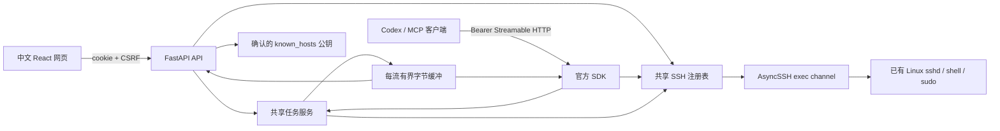

# 架构与生命周期

单个 Uvicorn worker 同时托管 React 构建资源、FastAPI API 和官方 MCP Python SDK 2.3.0 的 Streamable HTTP ASGI 路由。SDK 负责协议协商、工具 schema 和 JSON/SSE；不自行实现 JSON-RPC。采用 SDK v2 接口与自身 lifespan/session manager，不混用 v1 示例。无需 stdio 桥接。

网页只创建/断开连接、设置 sudo、读取/取消任务。六个 MCP 工具只发现连接、提交/读取/取消任务；不能创建连接或改 sudo 授权。两者调用同一个 `Services`、注册表和任务调度器。刷新/关闭浏览器不会断开 SSH。

每次命令建立新的非 PTY exec channel，cwd/env 不延续。AST 先完整检查整条命令，再排队；sudo 关闭时有副作用的命令前缀也不会执行。每连接锁使“重新读取最新 sudo 策略、取得密码内存快照、创建 channel”与网页改策略互斥。排队时关闭会拒绝，已开始任务使用快照直到结束。

任务由后台调度器管理，独立于 MCP HTTP 请求。状态为 queued → running → finished / failed / timed_out / cancelled / disconnected。远端非零退出仍为 finished；缺失退出信息、传输故障不会误报成功。stdout/stderr 并行读取、硬上限后继续排空；连接故障不自动重连或重放。取消尽力发信号并关闭 channel，不能保证已脱离 shell 的后代进程停止。

SSE `/api/events` 只发送刷新提示，不另存输出副本。网页通过已认证 API 拉取真实元数据和增量输出；输出纯文本、ANSI 控制序列不执行，滚动时保留用户视角。列表提供有限命令预览，详情读取完整命令。没有 localStorage/sessionStorage 凭据存储。

启动生成短期一次性配对码；配对 cookie、CSRF、MCP token、SSH session ID 相互独立。所有 API/订阅受 cookie 认证，修改需可信 Origin 与 CSRF；MCP 需独立 Bearer，并允许本机非浏览器客户端没有 Origin。Host 限 localhost/loopback；请求体最多 256 KiB，读取最多 10 秒。API/MCP 响应 no-store。token 轮换撤销已有请求和 SSE，但不取消已经提交的后台命令。

SSH 认证仅使用网页提交材料，一次性回调释放密码/私钥；禁用 agent、转发、默认私钥、用户 SSH 配置与 ProxyCommand。探测得到公钥后必须确认，认证时直接 pin 同一公钥，防止探测与认证间换钥。掉线清除连接的 sudo 密码；停机先取消任务，再关闭连接，清除网页授权。

所有连接元数据、sudo 密码、任务命令和输出仅驻留进程。有限的已过期 ID 提示记录也只在内存；仅确认公钥落盘。释放 Python 引用不能保证物理内存擦除。用户命令输出本身可能含秘密，系统不承诺通用脱敏；工具提交的认证材料和内部随机控制标记不能进入结果或普通诊断日志。
