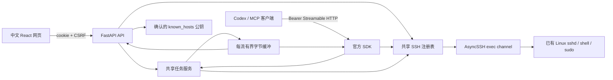

# 架构与生命周期

单个 Uvicorn worker 同时托管 React 构建资源、FastAPI API 和官方 MCP Python SDK 2.3.0 的 Streamable HTTP ASGI 路由。SDK 负责协议协商、工具 schema 和 JSON/SSE；不自行实现 JSON-RPC。采用 SDK v2 接口与自身 lifespan/session manager，不混用 v1 示例。无需 stdio 桥接。

网页创建/编辑/重连/断开/删除连接、切换 sudo、读取/取消命令任务；没有文件传输界面或文件操作 API。十个 MCP 工具发现连接、提交/读取/取消命令与文件传输；不能创建连接或改 sudo 授权。两者共享 `Services`、注册表和任务调度器，传输服务仅供 MCP 使用。刷新/关闭浏览器不会断开 SSH。

每次命令建立新的非 PTY exec channel，cwd/env 不延续。普通命令保留原文，由远端 shell 决定语法是否支持；AST 只用于识别和替换自动认证的 sudo 调用。可识别的 sudo 关闭时有副作用的命令前缀也不会执行。每连接锁使“重新读取最新 sudo 策略、取得密码内存快照、创建 channel”与网页改策略互斥。排队时关闭会拒绝，已开始任务使用快照直到结束。动态程序和嵌套 shell 内部的提权由远端权限限制，开关不是权限沙箱。

任务由后台调度器管理，独立于 MCP HTTP 请求。状态为 queued → running → finished / failed / timed_out / cancelled / disconnected。远端非零退出仍为 finished；缺失退出信息、传输故障不会误报成功。stdout/stderr 并行读取、硬上限后继续排空；连接故障不自动重连或重放。取消尽力发信号并关闭 channel，不能保证已脱离 shell 的后代进程停止。

SSE `/api/events` 只发送刷新提示，不另存输出副本。网页通过已认证 API 拉取真实元数据和增量输出；输出纯文本、ANSI 控制序列不执行，滚动时保留用户视角。列表提供有限命令预览，详情读取完整命令。`GET /api/transfers?session_id=...&limit=100` 按来源或目标连接筛选内存中的传输记录，清理过期项后按创建时间倒序返回，最多 1000 条；网页随 SSE 提示刷新进度和结果。没有 localStorage/sessionStorage 凭据存储。

启动生成短期一次性配对码；配对 cookie、CSRF、MCP token、SSH session ID 相互独立。所有 API/订阅受 cookie 认证，修改需可信 Origin 与 CSRF；MCP 需独立 Bearer，并允许本机非浏览器客户端没有 Origin。Host 限 localhost/loopback；请求体最多 256 KiB，读取最多 10 秒。API/MCP 响应 no-store。token 轮换撤销已有请求和 SSE，但不取消已经提交的后台命令。

SSH 认证使用网页提交材料或当前连接配置中保存的私钥；一次性认证回调结束后清空自身引用。账户密码保留在连接内存，sudo 开启时复用，关闭时撤销 sudo 使用但保留登录密码以便再次开启。禁用 agent、转发、默认私钥、用户 SSH 配置与 ProxyCommand。探测得到公钥后必须确认，认证时直接 pin 同一公钥。掉线清除账户密码和 sudo 授权；停机先取消文件传输与命令，再关闭连接，清除网页授权。

连接元数据、认证方式和私钥以原子替换方式写入权限 0600 的连接配置文件，密码和私钥口令永不写入。启动恢复原 session_id 和配置，状态为 disconnected，sudo 默认关闭；重连仍需探测和核对主机身份。新建或编辑使用别名＋纳秒时间＋随机量的 SHA256 生成 ID；保存编辑原子撤销旧 ID，无别名回退，随后取消旧 ID 的任务和传输。排队任务在取得连接锁后再次核对 ID，防止与编辑竞争。修改地址、账号、认证方式或私钥会关闭旧连接。密码可在编辑时补填/清除。删除同步移除保存的配置并断开连接。任务命令、输出和传输进度记录仅驻留进程。释放 Python 引用不能保证物理内存擦除。

MCP 目录浏览与路径预检查使用 SFTP；文件和递归目录传输使用本机 rsync。通过权限 0700 的临时目录内 Unix socket 和 rsh bridge，将 rsync 协议连接到现有 AsyncSSH exec channel；不启动新的 SSH 认证，不导出私钥、不写密码、不使用 sshpass。远端只运行经过 shlex 引用的 rsync --server 命令；--protect-args 传递实际文件路径。本地路径限制在配置的文件目录内，远端路径须绝对路径。本地↔远端直接 rsync，远端↔远端先下载到独立的容器临时目录，再 rsync 到另一端。每个中转批次目录权限 0700，使用纳秒时间及 transfer_id 命名，按创建次序保留最近 7 次，失败和取消的批次也计数。每次传输开始及批次建立/结束时检查，串行清理超额目录；活动目录受保护，释放后再检查。保留规则独立于内存进度记录的到期时间，服务重启后仍可扫描磁盘批次，不触碰非托管目录和本地源/目标文件。rsync 默认临时文件提交，不使用 --inplace、--delete；目录取消时已完成的文件会保留。非覆盖目录使用 --ignore-existing。进度来自 rsync progress2/stats，并通过 MCP 返回下载/上传阶段。Docker 镜像包含 rsync，本地文件与中转目录均位于 /tmp，不使用文件持久卷。
