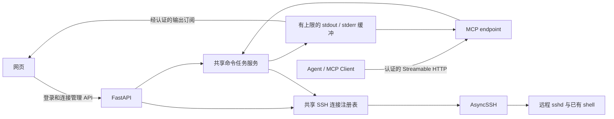

# SSH MCP 项目方案（已确认）

本文记录已确认的需求、实现方案和验收标准。对应的完整实施提示词见 `codex-goal-prompt.md`。本轮交付方案与提示词，不启动系统实现。

## 1. 目标与边界

系统启动后提供网页。操作者在网页输入远程 SSH 地址、端口、用户名和认证材料，验证远程主机身份并建立连接。Agent 连接本系统的 MCP endpoint，发现可用 SSH 会话，通过 MCP 工具执行命令并读取结果。

远程服务器只需要已有 SSH 服务、相应权限和命令运行环境，不安装本项目的服务、Agent、Python 包或守护进程。命令使用已有远程 shell 执行。

“所有用户”指同一个本地操作者通过网页登录的多个远程 SSH 账号，不实现多个网页用户或租户隔离。

## 2. 技术栈

| 层 | 推荐方案 | 作用 |
| --- | --- | --- |
| Python 环境 | uv、pyproject.toml、uv.lock | 创建环境、锁定依赖、执行开发和测试命令 |
| 后端 | FastAPI、Uvicorn、Pydantic | Web API、认证、输入校验、应用生命周期 |
| SSH | AsyncSSH | 异步连接、远程 exec、输出读取、连接生命周期 |
| MCP | 官方 Python SDK | 注册工具、协议协商、Streamable HTTP |
| 前端 | React、TypeScript、Vite | 连接管理、主机指纹确认、任务与输出展示 |
| 前端包管理 | npm 与 lockfile | Node 依赖管理；uv 只负责 Python 环境 |
| 本地状态 | OpenSSH known_hosts + 内存状态 | 仅主机信任公钥记录允许落盘；连接、任务、凭据和命令结果仅内存，不引入 SQLite |
| 质量检查 | Ruff、pytest、类型检查、前端构建与必要 E2E | 实际验证端到端行为 |
| 部署 | uv 本地运行、Docker Compose | 开发启动、生产静态资源和 Python 后端一起运行 |

实现开始时核对官方 SDK 当前稳定版本和目标 Agent 客户端支持，固定兼容依赖并提交锁文件。不要混用不同 SDK 大版本的示例 API。

## 3. 架构



核心业务只有一份。REST API 和 MCP 工具都是适配层，调用同一个连接服务和任务服务。网页连接不会因为浏览器关闭就断开，除非用户主动断开、连接故障、应用关闭或达到约定的空闲策略。

第一版运行单个后端进程、单个 worker。连接和任务对象属于这个进程；不支持多 worker 或横向扩容。

MCP 协议会话、网页登录会话和 SSH 会话使用不同 ID，不能相互替代。Agent 发现时和调用时都检查连接状态及调用者权限。

## 4. 网页功能

1. 本地管理入口认证；认证后显示连接列表和任务列表。
2. 新建连接：名称、host、port、username、密码或私钥、私钥 passphrase。
3. 首次连接显示主机公钥类型和 SHA256 指纹，用户确认后保存信任记录，再传递 SSH 认证材料进行登录。指纹改变时拒绝并要求显式处理。
4. 列表展示连接 ID、别名、主机、用户名、状态、建立时间和最近活动时间；不显示密码、私钥或 passphrase。
5. 主动断开与重新登录；连接异常给出可理解的错误，状态及时更新。
6. 每个连接提供独立的“允许 sudo”实时开关和 sudo 密码输入/清除操作。开关默认关闭；密码仅保存在后端内存，不进入浏览器 localStorage、数据库、URL、日志或 MCP 结果。
7. 展示经 MCP 发起的任务、命令状态、退出码、stdout 和 stderr，支持读取分段输出、取消任务和筛选；网页不提供命令输入框、交互终端或文件管理。
8. 提供 MCP 接入说明和 endpoint。MCP token 仅在安全的生成流程中展示，后续展示已配置状态；支持轮换。

前端采用 React + TypeScript + Vite。页面是本地运维工作台：桌面端左侧为 SSH 连接列表，右侧为当前连接的状态、sudo 控制和 Agent 命令记录；窄屏时连接列表移到上方。命令详情以等宽纯文本展示 stdout/stderr，不执行远程输出中的 HTML、脚本或终端控制序列。连接新建表单包括别名、主机、端口、用户名、密码或私钥、私钥口令；首次连接先展示主机指纹确认步骤。顶部提供 Codex/MCP 接入说明，不把秘密放进可复制的前端状态。

## 5. MCP 接口

推荐主入口 `http://127.0.0.1:8000/mcp`，使用 Streamable HTTP 与 Bearer token。端口可配置。避免另启一个不共享状态的 MCP 进程。

stdio 仅在目标客户端需要时加入。stdio 应作为连接运行中 HTTP 服务的桥接器，不应创建另一套 SSH 注册表。旧版 SSE 兼容也按目标客户端实际需要决定。

推荐工具如下：

| 工具 | 输入 | 输出/行为 |
| --- | --- | --- |
| `ssh_list_sessions` | 可选状态过滤 | 调用者有权使用的连接元数据；不包含认证材料 |
| `ssh_get_session` | session_id | 当前状态、主机和权限允许展示的信息 |
| `ssh_execute` | session_id、command、timeout、可选 cwd/env、可选请求幂等键 | 快速命令返回结果，长命令返回 run_id，使用同一个任务生命周期 |
| `ssh_get_run` | run_id | queued/running/finished/failed/timed_out/cancelled/disconnected 等状态、退出信息 |
| `ssh_read_output` | run_id、stdout_cursor、stderr_cursor、limit | 分段 stdout/stderr、新游标、是否结束、是否截断 |
| `ssh_cancel_run` | run_id | 尝试终止远程执行并返回可验证的本地状态 |

连接建立和断开入口在网页。MCP 不提供建连、断连、修改 sudo 策略或交互 PTY 的工具。

所有工具使用有说明的参数 schema 和结构化结果。工具失败区分参数错误、无权限、会话不可用、认证失败、SSH 通道错误、超时等；不能把非零远程退出码伪装成系统异常。

命令结果包含 `session_id`、`run_id`、任务状态、退出码/信号、起止时间、stdout、stderr、截断标记和结构化错误。成功或失败都不返回秘密。

## 6. 命令语义与任务管理

- 每次默认使用独立 SSH exec channel；上一次的 `cd` 和环境变量不自动保留。需要上下文时显式指定 cwd/env，或在同一次命令中完成。
- cwd/env 包装必须正确处理 shell 引用和环境变量名称，不能简单拼接用户路径。第一版支持 Linux/POSIX 远程 shell，明确验证的具体 shell 范围，不承诺 Windows 或网络设备兼容。
- `command` 是调用者授权执行的远程 shell 命令，支持管道、重定向、`;`、`&&`、`||`、子 shell 和命令替换；不在本地使用 shell 执行它。
- stdout/stderr 分别持续读取，缓冲有硬上限；不能使用先完整收集再截断的方式。
- 推荐默认执行上限 60 秒、可配置最大 3600 秒；MCP 仅短时间等待，长任务由 Agent 根据 run_id 查询，具体数值可以调整。
- 推荐每任务最多保留 stdout 和 stderr 各 1 MiB；超限明确报告截断，继续排空或按配置终止，不能无限积累。
- 限制全局和单连接并发、排队长度、任务数量和任务保留期限；推荐初始上限全局 16、每连接 4，任务完成后保留 30 分钟。
- 浏览器离开、MCP 短请求结束和远程任务取消是不同事件；定义并测试相应状态转换。
- 连接断开不自动重放命令，避免重复运维操作。连接恢复后不声称原任务成功。
- 幂等键只在同一服务实例和规定期限内防止重复创建任务，不保证远程操作跨重启 exactly-once。
- 取消/超时关闭通道并尽力向远程进程发送信号；不能保证所有脱离 shell 的进程或不支持信号的 SSH 服务都被终止。结果与文档如实描述。

### sudo 开关与复杂命令

- 每个 SSH 连接维护独立的 `sudo_enabled` 和内存中的 `sudo_password`。二者绝不由 Agent 设置；Agent 只能提交命令。网页修改开关或密码后，后端立即更新该连接的内存策略。
- 任务入队时可预检查，但在创建远程 channel 之前必须重新读取当前连接策略并完成原子授权，记录策略版本。任务开始时已允许 sudo 的命令继续使用该任务的授权快照；之后关闭开关阻止新任务获得 sudo，不强行中断正在运行的任务。排队期间关闭开关的 sudo 任务必须在任何远程执行前被拒绝。
- 采用 shell 语法树识别真正的 sudo 调用。不能用前缀正则、全局替换或简单 split 切开连接符。处理普通 sudo、显式路径（例如 `/usr/bin/sudo`）、支持的 `command`/`env` 前缀，并遍历命令列表、`&&`、`||`、`;`、管道、括号子 shell 和命令替换。`echo 'sudo id'` 和注释中的 sudo 是普通文本。
- sudo 关闭时，只要发现受策略管理的 sudo 调用，就在任何远程执行发生前拒绝整个任务。例如 `touch file; sudo id` 必须连 `touch file` 一并阻止。不能仅依赖 `sudo -n`，因为远程主机可能配置免密 sudo。sudo 开启不意味着把整个复合命令提升为 root，只有原本的 sudo 子命令获得提权。
- 语法转换保持原命令的引号、重定向、连接符和退出码逻辑。第一版明确支持的语法范围；语法错误、解析器未支持的结构或不能可靠处理的动态提权写法返回 `UNSUPPORTED_COMMAND_SYNTAX`，不能退回不受控的原样执行。命令文本中出现 shell 或 sudo 字样不自动构成提权调用，判断以语法为准。
- 密码通过 SSH 的受控内存通信传递，禁止放入远程命令行、环境变量、命令日志或文件。处理错密码、无需密码、密码提示不带换行、提示跨输出块、多个 sudo 以及超时。仅检查 stderr 提示再写 SSH stdin 不能作为通用方案：管道和重定向可能改变 sudo 的 stdin。
- 实现前做 sudo 密码与管道输入分离的可行性验证，至少包含 `printf 'data\\n' | sudo tee /tmp/test-output`，保证数据和密码不混淆、密码不会变成命令输入或输出，NOPASSWD 和认证缓存情形同样不泄漏密码。不能假设另一个 SSH channel 上的 `sudo -v` 一定能授权当前 channel。优先使用已有远端 shell/sudo 能力，不安装远程服务。不能满足上述条件的语法必须在执行前明确拒绝，并记录实际支持范围。
- 任意远程脚本、Python 或动态嵌套 shell 能自行调用 sudo；本地语法处理无法提供主机级强制权限隔离。root 账号本身也不受此开关降权。实现须向用户说明该边界，不声称可以阻止所有间接提权。严格禁止提权必须由远端账号和 sudoers 配置保证。
- 密码为空时仅允许无需输入密码的 sudo；需要密码则返回“未配置 sudo 密码”。清除密码、断开连接和应用退出时释放相应内存引用；关闭开关默认清除该连接保存的 sudo 密码，正在运行的任务保留已取得的授权快照。
- 任务记录只保存是否使用 sudo、授权快照时间和退出结果，不保存 sudo 密码；输出中的密码提示按需过滤，但不能假设任意远程输出都可自动脱敏。

## 7. 认证、凭据与主机信任

单机单操作者，默认只监听 127.0.0.1。采用启动时生成的一次性本地配对码换取 HttpOnly、SameSite cookie，不构建用户注册系统。配对码只在受控启动终端展示，不放 URL 或常规日志；生产日志不得记录认证请求体。允许通过环境变量配置固定 MCP token，否则生成进程内高熵 token，由已配对网页完成首次展示和轮换。token 通过 Authorization header 传递，不能放在 URL。

网页会话要防 CSRF；Host、Origin、CORS 策略限定可信来源。输出订阅同样需要认证，不能依靠知道连接/任务 ID 获得访问。前端输出使用纯文本，不执行远程输出中的 HTML、脚本或终端控制序列。

不支持公网或多用户部署，不实现 OAuth、用户数据库或共享授权。

推荐密码、私钥和 passphrase 只存在内存，不写数据库、浏览器 localStorage、日志或 Git。成功登录后尽快释放不再需要的认证材料；不保留秘密以便自动重连。Python 对象释放不等于可保证的物理内存擦除。

仅允许持久化用户确认的主机信任公钥记录；连接配置、任务、命令输出和 sudo 策略只存内存，进程重启后重新连接。凭据持久化和重启自动登录不在范围内。

禁用 SSH agent forwarding，并禁用隐式读取本机 ssh-agent、任意本机私钥和 OpenSSH 配置中的 ProxyCommand。用户明确选择的认证材料和主机参数才用于连接。

内存任务记录包含调用来源、连接 ID、任务 ID、时间、状态、退出码，以及供网页查看的命令和结果。诊断日志只允许必要的非秘密元数据；完整命令和输出不持久化。不能用日志掩码声称任意远程输出都已脱敏。

默认不根据简单关键词拦截命令。若需要只读或审批模式，要另行确定可验证的授权机制；Agent 获得 exec 权限意味着可以用该 SSH 账号现有权限执行任意命令。

## 8. API 与目录

API 推荐包括认证、host key 探测/确认、连接新建/查询/断开、任务查询/取消、经认证的事件或输出订阅、MCP token 生成与轮换。秘密输入和返回模型分开定义；API 文档示例不得包含真实凭据。

```text
pyproject.toml
uv.lock
src/ssh_mcp/
  app.py
  config.py
  auth/
  api/
  mcp_server/
  ssh/
  jobs/
  host_keys/
  schemas/
frontend/
  package.json
  package-lock.json
  src/
tests/
  unit/
  integration/
  e2e/
docs/
  architecture.md
  configuration.md
  mcp-client-setup.md
  operations.md
Dockerfile
compose.yaml
.github/workflows/ci.yml
.env.example
.gitignore
README.md
```

生产构建由 FastAPI 提供前端静态资源，API、输出订阅和 MCP 同源。前端开发使用 Vite 代理。配置清楚说明绑定地址、端口、认证、数据目录、并发、超时、输出限制和日志保留。

## 9. 验证与完成标准

1. uv 可从锁文件恢复 Python 环境；前端可从 lockfile 安装并构建。
2. 网页可以用测试密码和加密私钥分别建立 SSH 连接；错误密码、无效私钥、认证超时和指纹变化都有正确处理。
3. 使用官方 MCP 客户端进行真实协议调用，在 HTTP 层完成协议建立和 tools/list、tools/call；不能只直接调用 Python 工具函数。
4. 网页建立两条连接，Agent 发现两条并在指定连接上执行命令，返回分别准确的 stdout/stderr 和退出码。
5. 测试长命令、多输出、非零退出、并发、取消、超时、连接掉线、断开时任务清理和启动/关闭生命周期。
6. 使用测试 SSH 服务验证 sudo 关闭、sudo 开启且密码正确/错误、空密码、免密 sudo，以及 `echo x && sudo id`、`echo x; sudo id`、管道、括号子 shell 和命令替换等场景；确认密码不出现在命令、日志、MCP 结果和持久化状态中。
7. 未认证访问、错误 token、非法 Origin 和 token 轮换有相应验证；本地单操作者版本不声称多租户隔离。
8. 使用本地测试 SSH 服务完成真实端到端验证，不依赖用户生产服务器。测试 fixture 中提供 SSH 服务不违反生产远程端免安装要求。
9. 至少一个浏览器 E2E 覆盖网页登录、指纹确认、SSH 建连、sudo 开关/密码设置、MCP 发起命令、网页查看结果与断开连接。
10. 静态检查、类型检查、必要测试和前端生产构建通过；Docker 启动和健康检查实际验证。
11. README 和操作文档说明启动、认证配置、目标 Agent 接入、重启行为、known_hosts 管理、sudo 开关语义、密码清除、取消语义和排障。未实际跑的验证不得宣称通过。

## 10. 实施与 Git 提交阶段

1. 确认需求，保存最终方案和可验收的任务清单；初始化项目、uv 与前端配置、Git 忽略规则。提交 `chore: initialize project and tooling`。
2. 完成 SSH 服务、连接注册表、主机信任流程与必要测试。提交 `feat: add SSH session management`。
3. 完成命令任务、输出上限、取消/超时和端到端测试。提交 `feat: add bounded remote command execution`。
4. 完成 MCP transport、工具与官方客户端集成测试。提交 `feat: expose SSH operations through MCP`。
5. 完成认证和安全边界。安全措施从最初实现，单独阶段用于补全与验收，不在之前暴露无认证的服务。提交 `feat: add access control and audit metadata`。
6. 完成网页连接和任务管理、浏览器验证。提交 `feat: add web SSH management interface`。
7. 完成部署、CI、操作文档和整体验收。提交 `docs: add deployment and agent integration guides`，必要代码变更使用适当提交类型。

每次提交前检查差异，只暂存任务相关文件，不提交秘密、数据库、运行日志、.venv、node_modules 或无关改动。不要自动 push。

规划阶段发现 `.git` 为受保护的空目录，`git status` 无法识别仓库。实施阶段先复核，在确实需要时通过环境的正常权限流程初始化 Git；不能删除受保护目录绕过限制，不能假装完成提交。Git 若被权限阻塞，应继续可执行的实现与验证，并清楚报告未完成提交。

## 11. 已确认需求

- 本机单操作者，登录多个 SSH 账号；不实现网页多用户或多租户。
- 默认绑定 127.0.0.1，主要兼容 Codex 的 MCP 客户端；Streamable HTTP 为主，按实际客户端兼容需要增加桥接。
- SSH 认证材料和 sudo 密码仅内存保存，不支持凭据持久化或重启自动重连。
- 第一版只包含命令执行、结果查看、连接管理和按连接 sudo 开关/密码；不包含交互终端、文件能力或网页手动执行命令。远程目标按 Linux/POSIX shell 设计。
- Agent 可直接执行该 SSH 账号权限内的任意命令；sudo 由网页按连接开启，允许网页输入内存中的 sudo 密码。完整命令/输出默认不持久化。
- 接受 React + TypeScript + Vite、FastAPI + AsyncSSH、uv、Docker Compose 与分阶段 Git 提交。
- 已确认：中文连接侧栏工作台布局，以及复杂 sudo 语法支持和任意远程程序可能间接提权的边界。

其余常规工程选择由实施 Agent 按此方案处理，不逐项请求许可。真正无法满足已确认需求、缺失必要权限或遇到不可逆动作时才说明具体阻塞。本轮只生成方案和 Goal 提示词，不启动实现。

## 官方资料

- MCP transports：https://modelcontextprotocol.io/specification/latest/basic/transports
- 官方 Python SDK：https://github.com/modelcontextprotocol/python-sdk
- AsyncSSH 文档：https://asyncssh.readthedocs.io/en/latest/
- Codex 长任务与 Goal 模式：https://developers.openai.com/codex/long-running-work
